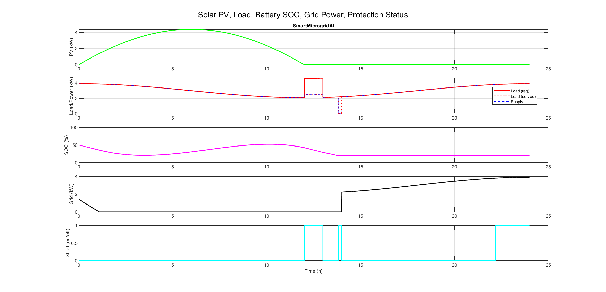

# SmartMicrogridAI ⚡

A solar-powered smart microgrid simulation prototype with intelligent energy management, battery storage, grid integration, and automated protection systems - built for MATLAB R2022b.

## Overview

SmartMicrogridAI is a **MATLAB script-based simulation prototype** that demonstrates the operation of a smart microgrid system. It integrates solar photovoltaic (PV) generation, battery energy storage, grid connectivity, variable electrical loads, and protection mechanisms including overload detection and automatic load shedding.

*Simulation results showing PV power, load demand vs served load, battery SOC, grid power, and protection status.*

## Key Features

- **Solar PV Generation**: Daily irradiance profile modeling with temperature effects and power derating
- **Battery Energy Storage**: Intelligent charging/discharging with State of Charge (SOC) monitoring (20% - 90% range)
- **Grid Integration**: Seamless operation in both grid-connected and islanded (outage) modes
- **Variable Load Management**: Dynamic electrical load profiles with disturbance scenarios
- **Smart Protection**: Overload detection and automatic load curtailment
- **Power Balance**: Real-time power flow management and served load tracking
- **Comprehensive Visualization**: Detailed plots of all system parameters

## Technology Stack

| Category | Technologies |
|----------|-------------|
| Simulation | MATLAB R2022b (Script-based) |
| Toolboxes | Simulink, Simscape, Simscape Electrical, Simscape Battery |
| Modeling | PV modeling, Battery energy management, Power flow control |
| Visualization | MATLAB plotting, Web-based dashboard (HTML/CSS/JS) |

## Project Structure

`	ext
SmartMicrogridAI/
├── main_sim.m              # Main MATLAB simulation script
├── README.md               # Project documentation
├── verification_report.md  # Simulation verification results
├── results/
│   └── SmartMicrogridAI_Results.png  # Simulation output plots
├── src/
│   ├── pvModel.m          # Solar PV power generation model
│   └── batteryModel.m     # Battery charging/discharging with SOC limits
├── models/                # Simulink models (placeholder for future extension)
├── docs/                  # Documentation
└── website/               # Professional animated web dashboard
    ├── index.html
    ├── css/style.css
    ├── js/app.js
    └── README.md
`

## Getting Started

### Prerequisites

- MATLAB R2022b installed
- Required toolboxes: Simulink, Simscape, Simscape Electrical, Simscape Battery

### Running the MATLAB Simulation

1. Open MATLAB R2022b and navigate to the project directory:

`matlab
cd('C:\Users\yagan\SmartMicrogridAI')
`

2. Run the simulation:

`matlab
main_sim
`

3. View results - The simulation will generate plots showing all system parameters and display verification checks in the command window.

### Running the Web Dashboard

The project includes a premium animated website for visualization. See [website/README.md](website/README.md) for detailed instructions.

Quick start:

`ash
cd website
python -m http.server 8000
`

Then open http://localhost:8000 in your browser.

**Note:** The website dashboard displays **demo/illustrative data only** and is **not connected to live MATLAB**. It serves as a visual presentation layer; the MATLAB simulation runs separately via main_sim.m.

## Verification Summary

From the latest simulation run:

- **SOC Limits**: Battery State of Charge maintained within 20% - 90%
- **Grid Outage**: Simulated outage window (10:00 - 14:00) exercises islanded mode
- **Load Curtailment**: Automatic load shedding activated during power shortages
- **Power Balance**: System power balance maintained with minimal error
- **Error-Free Execution**: Simulation completes without runtime errors

See [verification_report.md](verification_report.md) for detailed verification results.

## Future Roadmap

- [ ] **Simulink Model** - Develop complete block-diagram model using Simscape Electrical
- [ ] **Advanced MPPT** - Implement Maximum Power Point Tracking for PV system
- [ ] **Economic Optimization** - Add cost-based energy management strategies
- [ ] **Real-time Integration** - Connect to hardware for HIL testing
- [ ] **Machine Learning** - Implement load forecasting and predictive control
- [ ] **Grid Code Compliance** - Add reactive power control and grid support functions

## Notes

- **Prototype Status**: This is a MATLAB script-based simulation prototype, not a completed Simulink model.
- **Grid Convention**: Positive grid power = importing from grid, negative = exporting to grid
- **Battery Convention**: Positive battery power = charging, negative = discharging
- **Load Shedding**: Triggered during islanded mode deficits and grid-connected overloads
- **Demo Website**: The web dashboard displays illustrative/demo data clearly labeled as such.

## License

This project is open source and available under the [MIT License](LICENSE).

## Contributing

Contributions, issues, and feature requests are welcome! Feel free to check the issues page.
