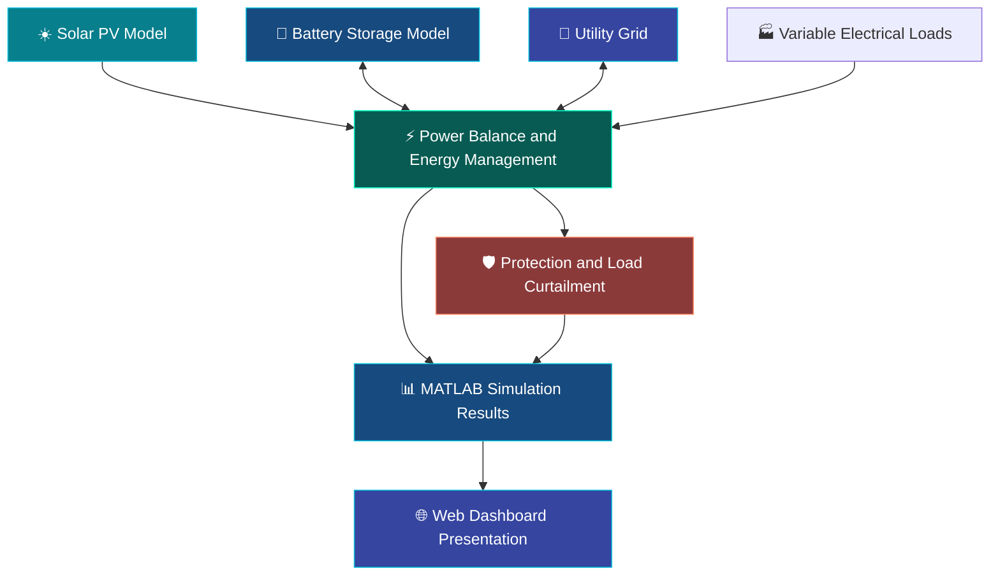

 <div align="center">

<a href="https://github.com/yagantieswarkurukunda6300-cell/SmartMicrogridAI">

</a>


<br/>

**A MATLAB-Based Smart Microgrid Simulation Prototype**

*Exploring renewable energy integration, battery storage, grid operation, power balancing, and automated load protection.*

<br/>

<a href="https://www.mathworks.com/products/matlab.html"></a>


<br/><br/>

<a href="#-overview">Overview</a> •
<a href="#-key-features">Features</a> •
<a href="#-system-architecture">Architecture</a> •
<a href="#-getting-started">Getting Started</a> •
<a href="#-developer">Developer</a>

</div>

---

## ⚡ Overview

**SmartMicrogridAI** is an electrical energy management project that models the operation of a smart microgrid integrating solar photovoltaic (PV) generation, battery energy storage, grid connectivity, variable electrical loads, and automatic protection mechanisms.

The project combines a MATLAB R2022b simulation with a visually rich web dashboard to demonstrate important concepts in modern power systems and renewable energy management.

The simulation explores how a microgrid responds to changes in solar generation, electrical demand, battery state of charge, and grid availability. It also models islanded operation and automatic load curtailment when available power is insufficient.

The accompanying website provides a presentation-oriented interface with animated visual elements and illustrative demonstration values.

> 🌱 **Project vision:** Explore smarter ways to balance renewable energy generation, storage, grid supply, and electrical demand.

<div align="center">


**Figure 1.** Simulation output visualizing key microgrid operating parameters.

</div>

## 🎯 Project Objectives

- Model solar PV power generation under changing irradiance and temperature conditions.
- Simulate battery charging and discharging with state-of-charge limits.
- Explore grid-connected and islanded operating conditions.
- Represent changing electrical loads and power shortages.
- Demonstrate automatic load curtailment during specified overload or supply-deficit conditions.
- Visualize power generation, demand, battery status, and grid power.
- Present the project through a modern, responsive web dashboard.

## ✨ Key Features

<table>
<tr>
<td width="50%" valign="top">

### ☀️ Solar PV Modeling

- Daily solar irradiance profile
- Temperature-related effects
- Power derating representation
- Variable renewable generation

</td>
<td width="50%" valign="top">

### 🔋 Battery Energy Storage

- Charging and discharging behavior
- State-of-charge monitoring
- Configured SOC operating range of 20–90%
- Energy balancing support

</td>
</tr>
<tr>
<td width="50%" valign="top">

### 🔌 Grid Integration

- Grid-connected operation
- Simulated grid outage
- Islanded operating conditions
- Grid import/export power representation

</td>
<td width="50%" valign="top">

### 🛡️ Intelligent Protection

- Overload condition detection
- Automatic load curtailment
- Supply-deficit handling
- Protection status visualization

</td>
</tr>
<tr>
<td width="50%" valign="top">

### 📊 Power Monitoring

- PV generation plots
- Load demand versus served load
- Battery SOC visualization
- Grid power and protection status

</td>
<td width="50%" valign="top">

### 🌐 Interactive Web Dashboard

- Animated interface elements
- Energy-themed visual design
- Simulation presentation panels
- HTML, CSS, and JavaScript frontend

</td>
</tr>
</table>

## 🏗️ System Architecture

<div align="center">



</div>

### 🔄 Operational Workflow

1. **Solar generation:** The PV model estimates available solar power using the configured irradiance and temperature profiles.
2. **Load demand:** The simulation represents electrical demand that changes over time.
3. **Energy balancing:** PV generation, battery power, grid power, and served load are considered in the modeled operating conditions.
4. **Battery operation:** Battery charging and discharging are modeled subject to the configured SOC limits.
5. **Grid response:** The simulation explores grid-connected and islanded conditions, including a defined outage scenario.
6. **Protection:** The model applies automatic load curtailment under configured power-shortage and overload conditions.
7. **Visualization:** MATLAB plots show the simulated operating parameters for analysis.

*The diagram describes the project's conceptual workflow. It does not imply that every subsystem is implemented as a physical controller or a separate Simulink block.*

## 🧰 Technology Stack

<div align="center">


</div>

| Component | Technology / Method |
|---|---|
| Simulation environment | MATLAB R2022b |
| PV generation | Script-based PV modeling |
| Battery management | SOC-constrained battery model |
| Power management | Power balancing and load management |
| Visualization | MATLAB plots |
| Web frontend | HTML5, CSS3, JavaScript |
| Version control | Git and GitHub |

**Toolbox note:** Simulink, Simscape, Simscape Electrical, and Simscape Battery are potential extensions for future model development. The current project is a MATLAB script-based prototype; the listed script workflow should not be interpreted as requiring those toolboxes unless the implementation is extended to use them.

## 📂 Project Structure

```text
SmartMicrogridAI/
│
├── main_sim.m
│
├── README.md
├── verification_report.md
├── .gitignore
│
├── src/
│   ├── pvModel.m
│   └── batteryModel.m
│
├── results/
│   └── SmartMicrogridAI_Results.png
│
├── models/
│   └── (Reserved for future model development)
│
├── docs/
│   └── (Reserved for additional documentation)
│
└── website/
    ├── index.html
    ├── README.md
    ├── assets/
    │   └── SmartMicrogridAI_Results.png
    ├── css/
    │   └── style.css
    └── js/
        └── app.js
```

### 📄 Core Files

- **`main_sim.m`** — Main MATLAB simulation entry point.
- **`src/pvModel.m`** — Solar PV generation model.
- **`src/batteryModel.m`** — Battery charging/discharging and SOC behavior.
- **`results/SmartMicrogridAI_Results.png`** — Saved simulation result visualization.
- **`verification_report.md`** — Simulation verification notes.
- **`website/index.html`** — Web dashboard structure.
- **`website/css/style.css`** — Dashboard presentation and styling.
- **`website/js/app.js`** — Dashboard interaction and illustrative data logic.

## 🚀 Getting Started

### 1. Prerequisites

- Windows, Linux, or macOS with a compatible MATLAB installation.
- MATLAB R2022b is the project's reference environment.
- A modern web browser for the dashboard.
- Python 3 if you want to serve the website locally using Python's built-in HTTP server.

### 2. Clone the Repository

```bash
git clone https://github.com/yagantieswarkurukunda6300-cell/SmartMicrogridAI.git
cd SmartMicrogridAI
```

### 3. Run the MATLAB Simulation

Open MATLAB and set the Current Folder to the cloned project directory.

Alternatively, run:

```matlab
cd('path/to/SmartMicrogridAI')
main_sim
```

Replace `path/to/SmartMicrogridAI` with the actual path on your computer.

The main script runs the configured simulation and displays its implemented plots and verification messages. Consult `verification_report.md` for the project's recorded verification information.

### 4. Launch the Web Dashboard

Open a terminal in the project directory and run:

```bash
cd website
python -m http.server 8000
```

Open the following address in your browser:

```text
http://localhost:8000
```

To stop the local server, press `Ctrl+C` in the terminal.

> **Important:** The web dashboard uses illustrative demonstration values and is not connected to live MATLAB simulation data. The MATLAB simulation and the web dashboard run independently.

## 📈 Simulation Scenarios and Monitoring

The prototype explores the following operating conditions:

| Scenario | What it demonstrates |
|---|---|
| Changing solar irradiance | Variation in modeled PV generation |
| Variable load demand | Changes in required electrical power |
| Battery charging | Increasing battery SOC within configured limits |
| Battery discharging | Battery support during power shortages |
| Grid-connected operation | Interaction with utility grid power |
| Simulated grid outage | Islanded operating conditions |
| Load curtailment | Reduction of served load under configured constraints |

### 📊 Parameters of Interest

- **PV power:** Modeled solar generation.
- **Load demand:** Total requested electrical power.
- **Served load:** Demand supplied after modeled load management.
- **Battery SOC:** State of charge, configured between 20% and 90%.
- **Grid power:** Grid import/export representation.
- **Protection status:** Indication of modeled protection or load-curtailment events.

**Sign convention used in the project:**

- Positive grid power represents power imported from the grid; negative power represents export.
- Positive battery power represents charging; negative battery power represents discharging.

The simulation plots and `verification_report.md` should be consulted for the actual recorded outputs. No unmeasured efficiency, accuracy, or cost-saving claims are assumed.

## ✅ Verification and Testing

The existing verification report describes checks related to:

- Battery SOC operating limits.
- A configured grid outage scenario.
- Automatic load curtailment under specified conditions.
- Power-balance behavior.
- Successful MATLAB script execution.

See [`verification_report.md`](verification_report.md) for the recorded verification details.

*Verification results apply to the tested simulation configuration. They are not equivalent to validation against physical hardware, grid-code certification, or field deployment.*

## 🛣️ Future Roadmap

The following are planned enhancements, not claims of completed functionality.

- [ ] **Simulink integration** — Develop a block-diagram model for the microgrid.
- [ ] **Advanced MPPT** — Explore maximum power point tracking for solar PV.
- [ ] **Predictive energy management** — Investigate forecasting-based energy decisions.
- [ ] **Machine learning** — Explore load forecasting and predictive control.
- [ ] **Battery health estimation** — Add battery degradation and health modeling.
- [ ] **Economic optimization** — Investigate energy costs and operating strategies.
- [ ] **Hardware-in-the-loop testing** — Explore real-time controller evaluation.
- [ ] **Grid support functions** — Investigate reactive power management and grid-support capabilities.
- [ ] **Live monitoring integration** — Connect the dashboard to a real data source in a future version.

## 🔮 Project Vision

The long-term vision is to develop the prototype into a more comprehensive smart microgrid platform for studying renewable energy integration, battery management, predictive energy control, and intelligent electrical protection.

The emphasis is on combining electrical engineering principles with simulation, software development, and data-driven energy management.

## 🤝 Contributions and Feedback

Suggestions, bug reports, and improvements are welcome.

If you want to contribute:

1. Fork the repository.
2. Create a feature branch.
3. Make and test your changes.
4. Submit a pull request describing the improvement.

Please distinguish proposed features from implemented functionality when documenting changes.

## 👨‍💻 Developer

<div align="center">


### **KURUKUNDA YAGANTI ESWAR**

**Electrical Engineering | Renewable Energy | AI & IoT Enthusiast**

*Interested in developing practical engineering projects that combine electrical systems, intelligent automation, simulation, and modern software technologies.*

<br/>

<a href="https://github.com/yagantieswarkurukunda6300-cell">

</a>
<a href="https://github.com/yagantieswarkurukunda6300-cell/SmartMicrogridAI">

</a>

<br/><br/>


**Engineering Intelligence. Empowering Energy. Building Tomorrow.** ⚡

</div>

---

<div align="center">

*SmartMicrogridAI — A simulation-driven exploration of smarter, cleaner, and more resilient energy systems.*

</div>
